# MahanAsterisk Monitoring

<p align="center">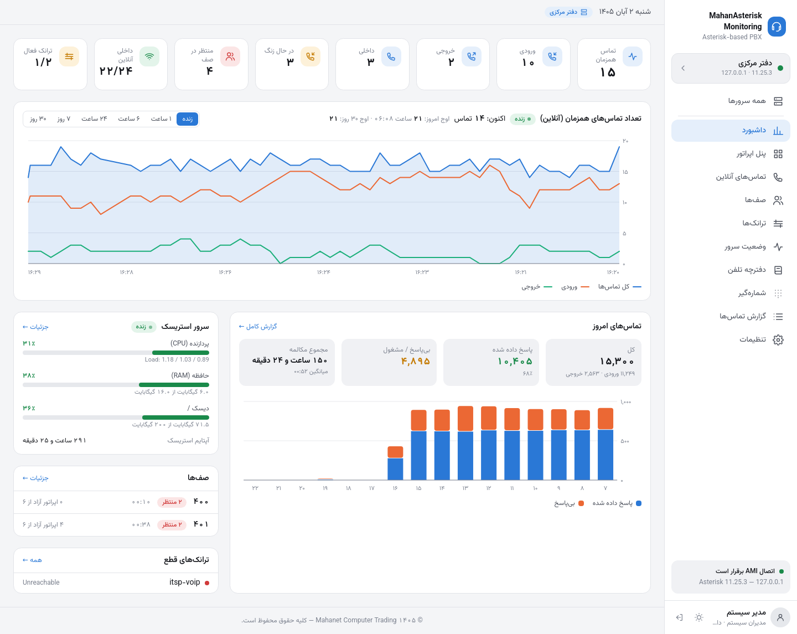</p>

**English:** a Persian (RTL) web operator panel and monitoring dashboard for **any Asterisk-based PBX** — plain Asterisk, Issabel, FreePBX, Elastix, VitalPBX — connected over **AMI** (Asterisk 1.8 → 20+, chan_sip and PJSIP). Live extension board with phone models, live calls with listen / whisper / barge and hang-up, queue monitoring, trunk management, server health (CPU / RAM / disk / services), phonebook with click-to-dial, web dial pad, CDR reports with a Jalali calendar and call-recording playback, several PBX servers in one panel, and access groups with per-section extension scopes. Node.js + PostgreSQL + React, deployed with Docker (`scripts/mahan-panel.sh install`).

## تصاویر

<table>
<tr><td width="50%"><a href="docs/screenshots/02-dashboard.png"></a><br><sub>داشبورد — نمودار زنده تماس همزمان · Dashboard — live concurrent calls</sub></td><td width="50%"><a href="docs/screenshots/03-operator-panel.png">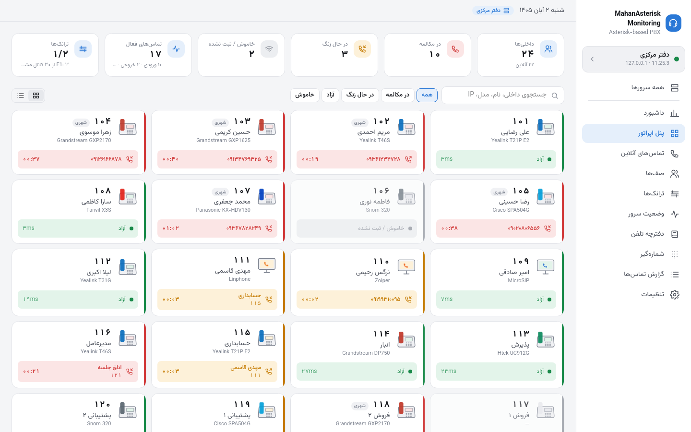</a><br><sub>پنل اپراتور با مدل تلفن‌ها · Operator panel with phone models</sub></td></tr>
<tr><td width="50%"><a href="docs/screenshots/05-live-calls.png">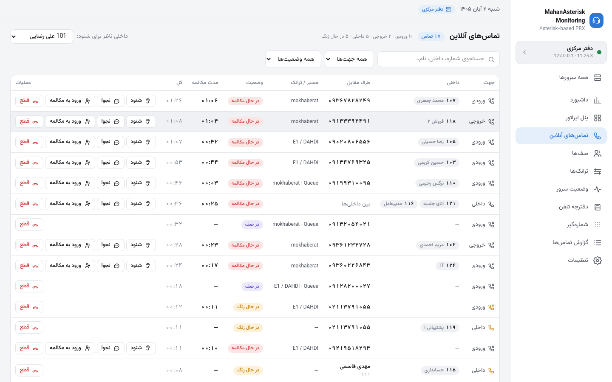</a><br><sub>تماس‌های آنلاین — شنود، نجوا، قطع · Live calls — listen, whisper, hang up</sub></td><td width="50%"><a href="docs/screenshots/06-queues.png">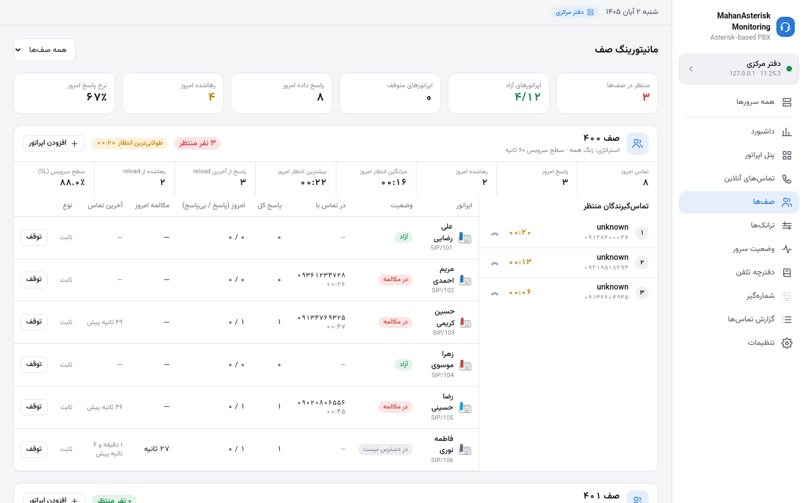</a><br><sub>مانیتورینگ صف · Queue monitoring</sub></td></tr>
<tr><td width="50%"><a href="docs/screenshots/07-server-status.png">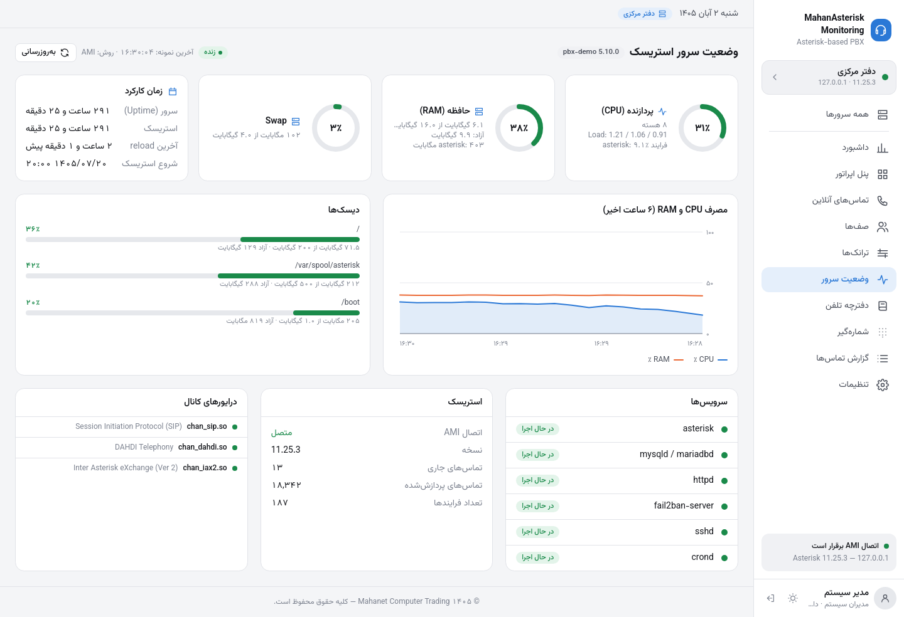</a><br><sub>وضعیت سرور (CPU، RAM، دیسک، سرویس‌ها) · Server health</sub></td><td width="50%"><a href="docs/screenshots/08-reports.png">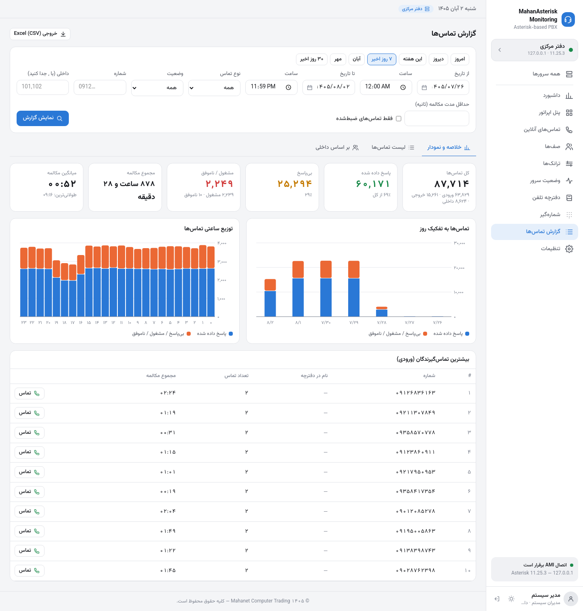</a><br><sub>گزارش تماس‌ها با تقویم شمسی · Call reports (Jalali calendar)</sub></td></tr>
<tr><td width="50%"><a href="docs/screenshots/09-call-list.png">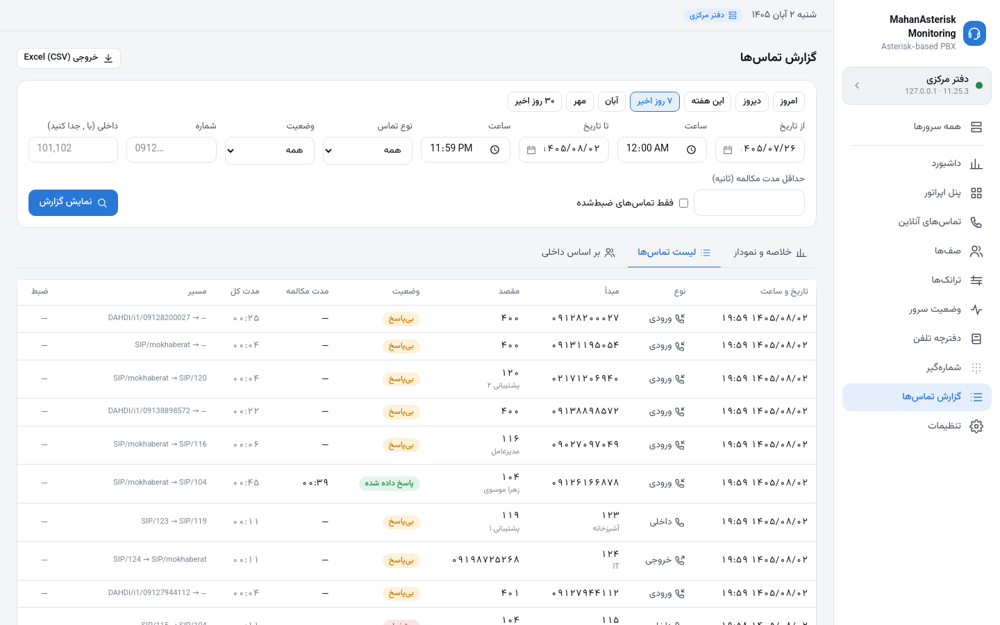</a><br><sub>لیست تماس‌ها و پخش ضبط مکالمه · Call list with recordings</sub></td><td width="50%"><a href="docs/screenshots/10-all-servers.png">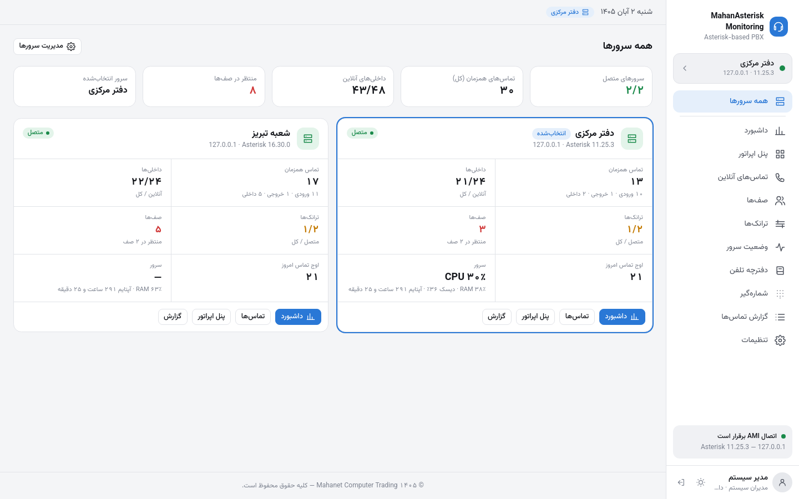</a><br><sub>چند سرور در یک پنل · Multiple PBX servers</sub></td></tr>
<tr><td width="50%"><a href="docs/screenshots/11-trunks.png">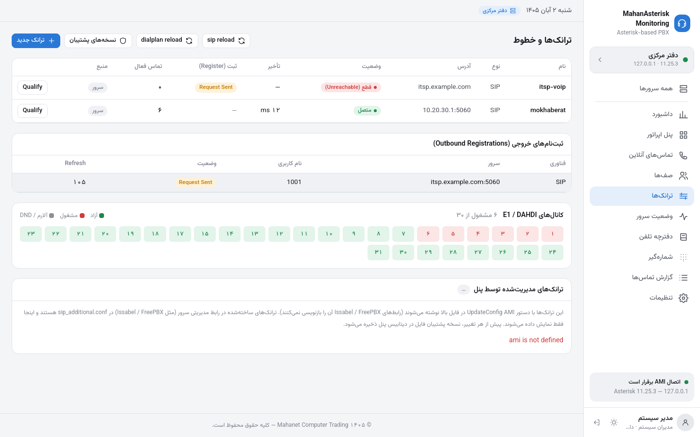</a><br><sub>ترانک‌ها و کانال‌های E1 · Trunks and E1 channels</sub></td><td width="50%"><a href="docs/screenshots/12-dialpad.png">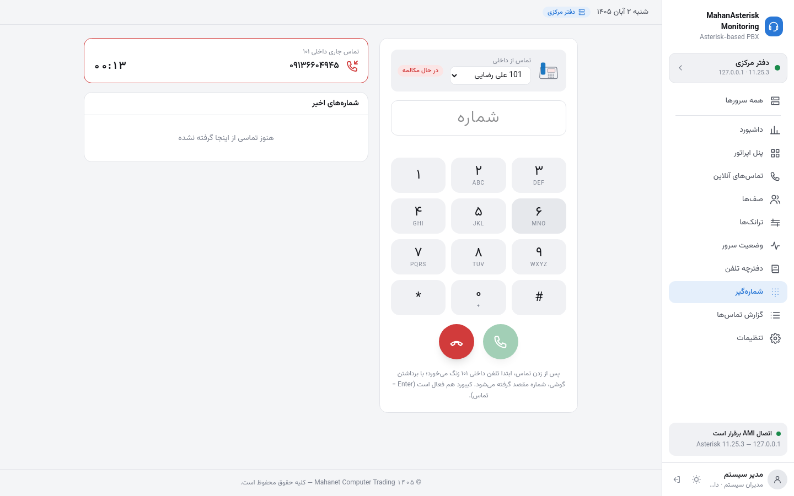</a><br><sub>شماره‌گیر وب و Click-to-Dial · Web dial pad</sub></td></tr>
<tr><td width="50%"><a href="docs/screenshots/13-access-group.png">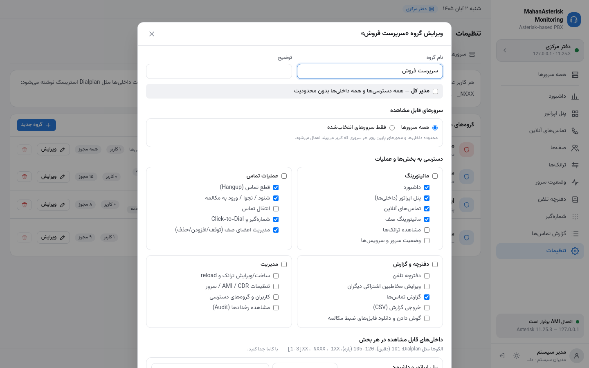</a><br><sub>گروه‌های دسترسی و محدوده داخلی‌ها · Access groups and extension scopes</sub></td><td width="50%"><a href="docs/screenshots/14-dashboard-dark.png">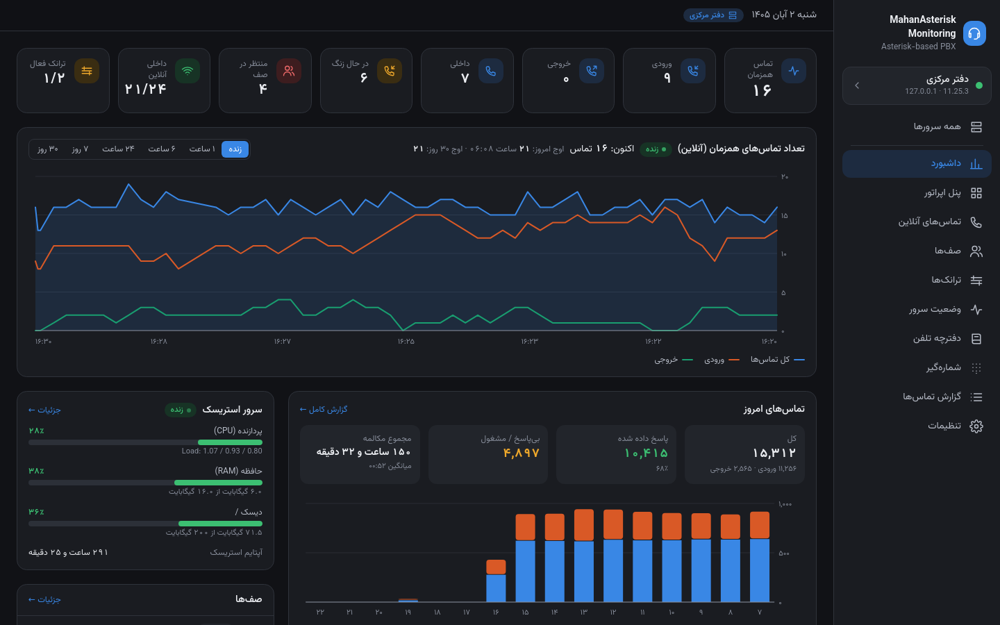</a><br><sub>پوسته تیره · Dark theme</sub></td></tr>
</table>

<details><summary>صفحه ورود و نسخه موبایل</summary>

<p>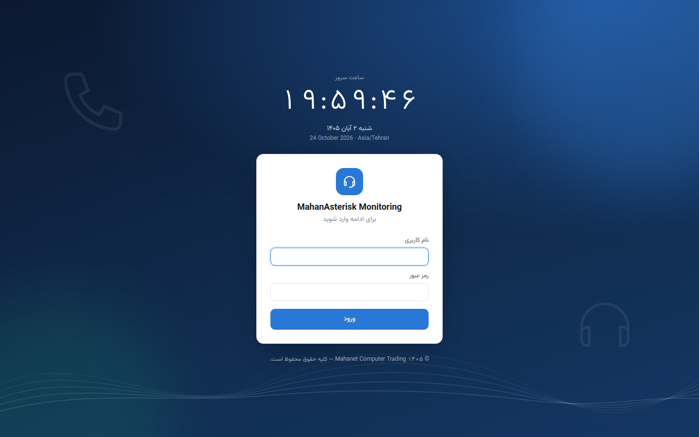 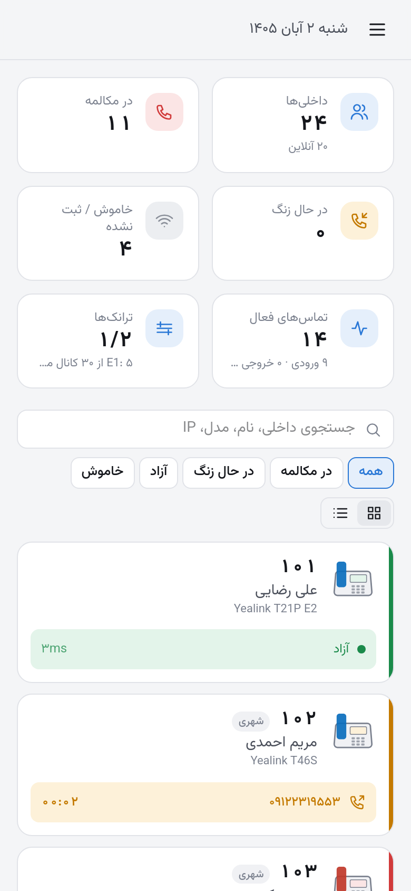</p>
</details>

> تصاویر از نسخه آزمایشی با استریسک شبیه‌سازی‌شده و داده‌های ساختگی گرفته شده‌اند.

پنل تحت وب فارسی (RTL) برای **همه سیستم‌های مبتنی بر Asterisk** (Asterisk خام، Issabel، FreePBX، Elastix، VitalPBX و …). همه چیز را از طریق **AMI** می‌گیرد و گزارش‌ها را از دیتابیس **CDR (MySQL/MariaDB)** سرور می‌خواند.

## امکانات

| بخش | توضیح |
|---|---|
| پنل اپراتور | همه داخلی‌ها به‌صورت کارت با **مدل تلفن** (از User-Agent: Yealink، Grandstream، Cisco، Snom، Panasonic، Fanvil، MicroSIP، Zoiper و …)، IP، تأخیر، وضعیت زنده (آزاد / زنگ / مکالمه / Hold / خاموش)، طرف مقابل تماس، تایمر. کشیدن و رها کردن کارت برای **انتقال تماس**. لیست تماس‌های فعال با ورودی/خروجی/داخلی و ترانک مسیر. |
| شنود تماس | شنود (Listen)، نجوا (Whisper) و ورود به مکالمه (Barge) با ChanSpy از طریق Originate؛ قطع تماس. فقط نقش سرپرست/مدیر؛ همه در گزارش رخدادها ثبت می‌شود. |
| ترانک‌ها | وضعیت، تأخیر، ثبت (Register)، تعداد تماس فعال، نقشه کانال‌های E1/DAHDI، Qualify، `sip reload` / `dialplan reload`. ساخت/ویرایش/حذف ترانک chan_sip با `UpdateConfig` در `sip_custom.conf` با نسخه پشتیبان خودکار. |
| دفترچه تلفن | مخاطب اشتراکی/شخصی، چند شماره، گروه، علاقه‌مندی، ورود/خروج CSV، **Click-to-Dial**؛ نام مخاطب در پنل و گزارش‌ها جای شماره نمایش داده می‌شود. |
| شماره‌گیر وب | Dial pad با کیبورد، پیشنهاد از دفترچه، شماره‌های اخیر، وضعیت زنده داخلی، قطع تماس. |
| گزارش تماس‌ها | **تقویم شمسی** (بازه‌های آماده: امروز، دیروز، این هفته، ماه جاری و قبل)، فیلتر نوع/وضعیت/شماره/داخلی/مدت، کارت‌های خلاصه، نمودار روزانه و ساعتی، پرتماس‌ترین شماره‌ها، آمار هر داخلی، لیست با صفحه‌بندی، پخش ضبط (اختیاری)، خروجی CSV با تاریخ شمسی برای Excel. |
| داشبورد | نمودار تعداد تماس همزمان (۱ ساعت تا ۳۰ روز، نمونه هر ۱۰ ثانیه در دیتابیس)، اوج امروز و ماه، شمارنده‌های زنده، خلاصه CDR امروز، صف‌ها، ترانک‌های قطع و سلامت سرور. |
| تماس‌های آنلاین | جدول همه تماس‌های جاری با جهت، داخلی، طرف مقابل، ترانک، مدت؛ قطع تماس و شنود/نجوا/ورود به مکالمه با انتخاب داخلی ناظر. |
| صف‌ها | KPI هر صف (منتظر، طولانی‌ترین انتظار، پاسخ/رهاشده امروز و از reload، سطح سرویس)، تماس‌گیرندگان منتظر با زمان زنده، اپراتورها با وضعیت، توقف/ادامه با دلیل، افزودن/حذف عضو پویا، آمار امروز هر اپراتور. |
| وضعیت سرور | CPU، RAM، Swap، دیسک‌ها، Load، آپتایم سرور و استریسک، سرویس‌ها (asterisk، mysql، httpd، fail2ban…)، نمودار ۶ ساعته؛ از طریق AMI (`SHELL()` با `live_dangerously`) یا SSH. |
| تنظیمات | اتصال AMI و CDR با دکمه تست، نوع کانال، context، الگوی داخلی به نحو Dialplan (`_XXX`)، پاسخ خودکار، مانیتورینگ سرور، گروه‌های دسترسی، کاربران، لاگ رخدادها. |

نسخه‌های پشتیبانی‌شده: Asterisk 1.8 / 11 (مثلاً Elastix، Issabel 2) و 13 / 16 / 18 / 20+ (مثلاً Issabel 4، FreePBX، VitalPBX، Asterisk خام) با chan_sip یا PJSIP. نسخه خودکار از `CoreSettings` تشخیص داده می‌شود.

نقش‌ها: **اپراتور** (فقط داخلی خودش در تماس و گزارش)، **سرپرست** (شنود، قطع، انتقال، تماس از هر داخلی)، **مدیر** (همه چیز + تنظیمات و ترانک‌ها).

## آماده‌سازی سرور استریسک

1. کاربر AMI در `/etc/asterisk/manager_custom.conf` (Issabel / FreePBX / Elastix) یا `/etc/asterisk/manager.conf` (Asterisk خام، با `enabled = yes` در بخش `[general]`):
   ```ini
   [panel]
   secret = یک-رمز-قوی
   deny = 0.0.0.0/0.0.0.0
   permit = PANEL_IP/255.255.255.255
   read = system,call,agent,user,config,command,reporting,originate
   write = system,call,agent,user,config,command,reporting,originate
   ```
   سپس `asterisk -rx "manager reload"`. پورت ۵۰۳۸ را فقط برای IP پنل باز کنید.
2. کاربر فقط‌خواندنی CDR در MySQL/MariaDB سرور (در Issabel/FreePBX دیتابیس `asteriskcdrdb`). اگر نمی‌خواهید پورت ۳۳۰۶ را باز کنید، در «تنظیمات › دیتابیس CDR» نوع اتصال را **از طریق SSH** بگذارید؛ پنل از همان کاربر SSH «مانیتورینگ سرور» تونل می‌زند و کاربر MySQL را برای `localhost` و `127.0.0.1` بسازید (مرحله `bind-address`/فایروال لازم نیست). اگر در `sshd_config` مقدار `AllowTcpForwarding no` است، در انتهای فایل اضافه کنید: `Match User panelmon` و زیر آن `AllowTcpForwarding yes` و `PermitOpen 127.0.0.1:3306`. در حالت مستقیم:
   ```sql
   CREATE USER 'panel'@'PANEL_IP' IDENTIFIED BY 'STRONG_PASSWORD';
   GRANT SELECT ON asteriskcdrdb.* TO 'panel'@'PANEL_IP';
   ```
   و اجازه اتصال از شبکه (`bind-address` و فایروال پورت ۳۳۰۶ فقط برای IP پنل).
3. پاسخ خودکار (اختیاری) برای Click-to-Dial و شنود: در تنظیمات › شماره‌گیری فعال کنید (هدر `Call-Info: answer-after=0` و `Alert-Info`).

## اجرا روی سرور توسعه

```bash
npm install
npm run build          # ساخت رابط کاربری در dist/
npm run dev            # سرور روی :3400 (فایل .env.local)
npm run mock:ami       # استریسک شبیه‌سازی‌شده روی 127.0.0.1:5038 (admin / mock) — MOCK_VERSION=16 برای رویدادهای جدید
npm test
```

## نصب و به‌روزرسانی (اسکریپت آماده)

اسکریپت `scripts/mahan-panel.sh` نصب، به‌روزرسانی، پشتیبان‌گیری و بازیابی را با Docker انجام می‌دهد (Ubuntu / Debian / Rocky / Alma …).

**نصب روی سرور جدید:**

```bash
git clone https://github.com/ashayesteh86/Asterisk-Monitoring.git /opt/mahanasterisk
sudo /opt/mahanasterisk/scripts/mahan-panel.sh install
```

اگر Docker نصب نباشد، با تأیید شما نصب می‌شود (فقط این مرحله root لازم دارد؛ کاربر عضو گروه docker بقیه کارها را بدون sudo انجام می‌دهد)؛ `panel.env` و `.env` با رمزهای تصادفی ساخته می‌شوند، کانتینرها بالا می‌آیند و آدرس و رمز اولیه admin چاپ می‌شود. گزینه‌ها: `--port 3400`، `--tz Asia/Tehran` (باید با منطقه زمانی سرور استریسک یکی باشد)، `--dir /opt/mahanasterisk`، `--key ~/.ssh/deploy_key`، `--branch main`، `-y` (بدون سؤال).

| دستور | کار |
|---|---|
| `sudo …/mahan-panel.sh update` | دریافت آخرین نسخه، پشتیبان دیتابیس، ساخت دوباره، بررسی سلامت و **برگشت خودکار به نسخه قبل** اگر بالا نیامد |
| `sudo …/mahan-panel.sh backup` | پشتیبان دیتابیس در `backups/` (۱۴ نسخه آخر نگه داشته می‌شود) |
| `sudo …/mahan-panel.sh restore <file.dump>` | بازیابی دیتابیس (قبلش پشتیبان گرفته می‌شود) |
| `sudo …/mahan-panel.sh status` / `logs` / `restart` | وضعیت، لاگ زنده، ری‌استارت |
| `sudo …/mahan-panel.sh admin-password` | رمز جدید تصادفی برای کاربر admin (اگر رمز فراموش شد) |

**به‌روزرسانی بدون دسترسی GitHub:** اگر سرور مقصد به GitHub دسترسی ندارد، یک مخزن bare روی همان سرور بسازید و از سرور توسعه به آن push کنید؛ `update` از همان مخزن pull می‌کند:

```bash
# روی سرور مقصد (یک بار)
git init --bare -b main ~/mahanasterisk.git && git -C ~/mahanasterisk remote set-url origin ~/mahanasterisk.git
# روی سرور توسعه، برای هر انتشار
git push production main   # remote: user@server:mahanasterisk.git
```

`APP_SECRET` در `panel.env` را نگه دارید و عوض نکنید؛ رمزهای AMI / MySQL / SSH سرورها با آن رمزنگاری شده‌اند.

## چند سرور

پنل می‌تواند به چند سرور مبتنی بر Asterisk هم‌زمان وصل باشد (می‌توانند از انواع مختلف باشند). هر سرور در «تنظیمات › سرورهای استریسک» تعریف می‌شود و تنظیمات AMI، دیتابیس CDR (مستقیم یا SSH)، شماره‌گیری و مانیتورینگ جداگانه دارد.

- در بالای منوی کناری، سرور فعلی انتخاب می‌شود؛ همه صفحه‌ها (داشبورد، پنل، تماس‌ها، صف، ترانک، وضعیت سرور، گزارش) اطلاعات همان سرور را نشان می‌دهند. انتخاب در مرورگر به خاطر سپرده می‌شود.
- صفحه «همه سرورها» وضعیت اتصال، تماس همزمان، داخلی‌های آنلاین، ترانک‌ها، صف‌ها و سلامت سرور همه سرورها را کنار هم نشان می‌دهد.
- در هر گروه دسترسی تعیین می‌شود کاربر «همه سرورها» یا «فقط سرورهای انتخاب‌شده» را ببیند.
- دفترچه تلفن، کاربران و گروه‌ها بین همه سرورها مشترک‌اند.
- بعد از ارتقا، تنظیمات قبلی به‌صورت خودکار «سرور ۱» می‌شوند.

## فایل‌های ضبط مکالمه

در «گزارش تماس‌ها › لیست تماس‌ها» کنار هر تماسِ ضبط‌شده دکمه پخش و دانلود هست (و فیلتر «فقط تماس‌های ضبط‌شده»). فایل‌ها با همان کاربر SSH «مانیتورینگ سرور» از `/var/spool/asterisk/monitor` (زیرپوشه سال/ماه/روز) خوانده می‌شوند؛ وب‌سرور یا اشتراک فایل لازم نیست. مسیر و روش (SSH، آدرس وب یا خاموش) در تب «دیتابیس CDR» هر سرور است. کاربر SSH باید اجازه خواندن داشته باشد:

```bash
setfacl -R -m u:panelmon:rX /var/spool/asterisk/monitor
setfacl -R -d -m u:panelmon:rX /var/spool/asterisk/monitor
```

مجوز «گوش دادن و دانلود فایل‌های ضبط مکالمه» در گروه دسترسی جدا است، محدوده داخلی‌های «گزارش» رعایت می‌شود و هر پخش/دانلود در رخدادها ثبت می‌شود.

## سطح دسترسی

هر کاربر عضو یک **گروه دسترسی** است (تنظیمات › گروه‌ها و سطح دسترسی). گروه دو چیز را تعیین می‌کند:

- **مجوزها**: دسترسی به هر بخش (داشبورد، پنل، تماس‌های آنلاین، صف، ترانک، وضعیت سرور، دفترچه، گزارش، تنظیمات) و هر عملیات (قطع، شنود، انتقال، Click-to-Dial، مدیریت صف، …).
- **محدوده داخلی‌ها در هر بخش**: پنل، تماس‌های آنلاین، شنود، تماس از داخلی، گزارش و صف‌ها — هرکدام «همه»، «فقط داخلی خود کاربر»، «فقط این موارد»، «همه به‌جز این موارد» یا «هیچ‌کدام». فهرست‌ها با نحو Dialplan نوشته می‌شوند: `101, 105-120, _2XX, _NXXX`.

سرور همه عملیات و داده‌ها (تماس‌های زنده، CDR، صف‌ها) را بر اساس همین محدوده‌ها فیلتر می‌کند. نمودار تماس همزمان داشبورد کل سیستم را نشان می‌دهد.

## نکات

- ترانک‌هایی که در رابط مدیریتی سرور ساخته شده‌اند (مثلاً `sip_additional.conf` در Issabel/FreePBX) فقط نمایش داده می‌شوند، چون همان رابط آن فایل را بازنویسی می‌کند.
- رشته `register` ترانک در بخش `[general]` فایل `sip.conf` افزوده می‌شود؛ پیش از هر تغییر نسخه پشتیبان در «ترانک‌ها › نسخه‌های پشتیبان» ذخیره می‌شود. ابتدا روی سرور غیرعملیاتی امتحان کنید.
- شنود مکالمه ممکن است الزامات قانونی/اطلاع‌رسانی داشته باشد؛ دسترسی آن فقط برای نقش سرپرست/مدیر است و ثبت می‌شود.

## مجوز (License)

Copyright © 2026 Mahanet Computer Trading

این برنامه نرم‌افزار آزاد است و تحت **GNU General Public License نسخه ۳** (یا به انتخاب شما هر نسخه بعدی) منتشر می‌شود. می‌توانید آن را استفاده، تغییر و بازتوزیع کنید، به این شرط که نسخه تغییریافته را هم با همین مجوز و همراه کد منبع منتشر کنید. متن کامل: [LICENSE](LICENSE).

This program is free software: you can redistribute it and/or modify it under the terms of the GNU General Public License as published by the Free Software Foundation, either version 3 of the License, or (at your option) any later version. It is distributed in the hope that it will be useful, but **without any warranty**; see the [LICENSE](LICENSE) file for details.
